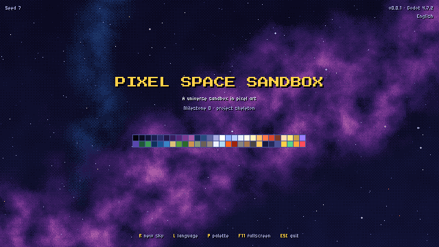

# PixelSpaceSandbox

A lightweight 2D pixel-art "god game" for PC: a universe sandbox where you
build or pick a star system, play with gravity, speed up time and watch the
consequences — light and gravity travel at the real speed of light — while
habitable worlds grow life and civilizations that reach for space.

Made with Godot 4 (Compatibility renderer) to run smoothly on weak PCs.

**Status:** milestone 0 (project skeleton) — see [docs/STATUS.md](docs/STATUS.md).



## Running the game

1. Install [Godot 4.7.2](https://godotengine.org/download) (standard build, not .NET).
2. Open Godot, choose **Import**, and select this folder's `project.godot`.
3. Press **F5** to run.

Keys on the title screen: **R** new sky, **L** language, **P** palette,
**F11** fullscreen, **Esc** quit.

## Test builds

Every push to `beta` or `main` builds the Windows and Linux executables on
GitHub Actions with the official Godot export templates, after running all
the checks, and starts the Windows build on a real Windows machine.

To download them: open the repository's **Actions** tab, pick the latest
**Build** run, and download **PixelSpaceSandbox-windows** or
**PixelSpaceSandbox-linux** from its **Artifacts**. On Windows, the first
launch shows "Windows protected your PC" because the game is not signed:
choose **More info → Run anyway**.

## Running the tests

The tests run headless (no window) and fail on any error or warning:

```sh
GODOT=/path/to/godot tools/run_tests.sh             # Linux
$env:GODOT="C:\path\to\godot.exe"; tools\run_tests.ps1   # Windows (PowerShell)
tools/run_tests.sh --filter=palette                 # only matching tests
```

To take a screenshot (needs a display, or `xvfb-run` on Linux):

```sh
godot --path . --script res://tools/screenshot.gd -- --out=shot.png --scale=2
```

## Project layout

| Folder | What lives there |
| --- | --- |
| `src/core/` | Cross-cutting code: palette, input bindings, the `App` autoload |
| `src/sim/` | The simulation: plain data and systems, no nodes, testable headless (from milestone 1) |
| `src/view/` | Presentation: nodes and drawing (sky, bodies, overlays) |
| `src/ui/` | Interface: screens, panels, theme |
| `scenes/` | Godot scenes |
| `data/` | Data-driven content (palette, key bindings; later presets, species, knowledge…) |
| `assets/` | Fonts and other assets, each credited in `docs/CREDITS.md` |
| `locale/` | Interface text in English and Portuguese |
| `tests/` | Headless tests and their runner |
| `tools/` | Test, screenshot and asset-generation scripts |
| `docs/` | Brief, design, status and credits |

## Documents

- [docs/BRIEF.md](docs/BRIEF.md) — the full product brief.
- [docs/DESIGN.md](docs/DESIGN.md) — technical design and decisions.
- [docs/STATUS.md](docs/STATUS.md) — what is done, in progress and planned.
- [docs/CREDITS.md](docs/CREDITS.md) — assets, licences and data sources.
